# 鲑鱼跑全武器六维数值分析

本文基于项目的 **11.1.0 参数快照**，比较 71 把主武器，包括 63 把普通武器和 8 把熊先生武器，共 137 个攻击模式。分析把击杀、射程、涂墨、整箱伤害、清杂和射击硬直分别量化，再用统一尺度呈现其差异。

六维分数采用 **0.5–5.0 分，高分表示该维度更有利**。项目已经将这些分数写入 `rating.dimensions`；原有 `rating.overall` 和 `rating.tier` 保持原值。文中的任务模型综合分作为独立对照结果，未替换网页原总分。

模型标识为 `1110-model-v2-reference-definitions`。本文图表与项目实现说明书的数据分析章使用同一批冻结结果。全文的距离和面积保留模型单位，除明确列出的秒数外，时间均以 60 F/s 的帧数表示。

## 阅读与数据入口

- [方法与六维定义](#1-数据与实验方法)
- [三把猎鱼弓的计算实例](#2-三把猎鱼弓的计算实例)
- [各类武器横评](#3-各类武器横评)
- [六维关联与任务时间](#4-六维关联与任务时间)
- [全武器结果](#5-全武器结果)
- [敏感性与讨论](#6-敏感性与讨论)
- [复算入口](#7-复算入口)
- CSV：[六维分数](../analysis/weapon_evaluation/v2/scores.csv)、[原始基准量](../analysis/weapon_evaluation/v2/benchmarks.csv)、[原总分与任务模型对照](../analysis/weapon_evaluation/v2/comparison.csv)。

## 1 数据与实验方法

### 1.1 参数快照和模式拆分

参数来自 [`data/weapon_data_1110`](../data/weapon_data_1110/)。普通武器使用已经合并普通参数与 Coop 覆盖的 `Merge_*.json`；打工专用熊武器使用 `Bear_*.json`。普通参数和打工参数的上游核对入口为 Leanny 的解包数据仓库。[[1]](#ref-1)

合并后的 JSON 仍可能省略类缺省字段。因此，读取时区分显式参数、有出处的类缺省值和未核实字段；不能把“没有写”一律解释成零。缺省值与字段释义分别参照参数研究表及日文验证资料，实际采用值保存在[缺省值登记表](../analysis/weapon_evaluation/notes/defaults_registry.json)中。[[3]](#ref-3) [[4]](#ref-4)

同一武器的不同动作分别建模，包括点射与满蓄、三连发、翻滚后射击、旋转枪长短射程状态、滚筒甩击与碾压、刀身与剑气、弓的不同充能阶段等。每个模式保留伤害事件、初次准备时间、攻击周期、耗墨、射程和退出窗口。五项生命值靶分别枚举完整模式；当前结果没有搜索任意跨模式组合的全局最优解。

### 1.2 六维的原始量

| 字段 | 中文含义与实验口径 | 原始量方向 |
| --- | --- | --- |
| Killing | 300、500、600 盾与 500 本体、900、1200 五项生命值靶的完成帧合计 | 越小越好 |
| Range | 平地不起跳，扫描仰角后的最远可达攻击距离代理 | 越大越好 |
| Inking | 熟练操作基准下的覆盖速率；默认墙涂与地面覆盖同效 | 越大越好 |
| Ink Efficiency | 一整箱墨能够造成的最大总伤害，排除碾压和推行 | 越大越好 |
| Mob Clearing | 2 只 400 血、3 只 100 血、3 只 40 血目标全部清除的完成帧 | 越小越好 |
| Endlag | 弹丸射出后，到角色能够开始潜墨的最短帧数 | 越小越好 |

五项靶用于隔离生命阈值与输出节奏。600 盾与 500 本体分阶段结算，盾的过杀不结转到本体；同一动作的后续独立伤害事件仍可进入下一阶段。300、500、900、1200 及盾体生命值，以及杂鱼的 40、100、400 生命值，可在三代鲑鱼跑数据页交叉核对。[[2]](#ref-2)

这些靶代表固定生命值实验。真实 Boss 的露出弱点、绕后、装甲状态、无敌窗口和飞行时间没有全部进入这项基准，因此完成帧不能直接解释为真实对局中遭遇该 Boss 后的击杀时间。

### 1.3 离散伤害事件和资源调度

击杀原始值为：

$$
T_{\mathrm{Killing}}=T_{300}+T_{500}+T_{600\rightarrow500}+T_{900}+T_{1200}.
$$

每项测试从满墨、未预蓄力开始。计时保留初次准备、连发间隔、三连发停顿、蓄力包和分段伤害事件；最终致死事件的零基帧加 1，作为完成帧。没有足够墨水支付完整动作或完整弹包时，先停止输出并补墨。连续接触不能一次击杀目标、且击退使持续接触假设不成立的模式，不参与对应击杀选优。

以斯普拉射击枪为例，冻结结果为：

| 生命值靶 | 300 | 500 | 600 盾与 500 本体 | 900 | 1200 | 合计 |
| --- | ---: | ---: | ---: | ---: | ---: | ---: |
| 完成帧 | 49 | 79 | 181 | 145 | 199 | 653 |

该例说明，单次伤害和生命阈值通过整数命中次数影响结果。持续 DPS 相近的武器，也可能因过杀、准备时间和补墨次数不同而产生不同的完成时间。完整逐靶数据见[原始基准 CSV](../analysis/weapon_evaluation/v2/benchmarks.csv)。

清杂中央场景使用 2 列 4 行点阵，按 400、400、100、100、100、40、40、40 逐行放置；目标密度设为 0.04，对应间距 5 个模型单位。每次动作选择即时有效伤害最大的瞄准模板，然后更新全部目标生命。爆风按几何范围、贯通按攻击通道、独立箭束按离散分配处理；爆破枪直击与爆风不重复计伤，弓不无条件追加同箭爆炸，爆炸桶的直弹与爆风两条伤害通道按其机制分别结算。这个贪心计划可重复计算，但不保证全局最佳瞄准路线。

实验统一使用归一化墨箱容量 1、整箱恢复 180 F、覆盖有效比例 0.55。上述数值是本实验的控制参数。清杂另计算每次只影响一个敌人的分散情景和同点聚集情景，用于观察队形变化带来的影响。

### 1.4 射程与涂墨

射程使用固定离地 1 个模型单位、仰角 0–45°、步长 1° 的平地扫描。普通弹道按直行、制动和自由飞行阶段处理重力与阻力，到首次落地或显式消失事件为止；适用模式再计入明确的弹丸碰撞半径。该方法参考了公开射程分析代码的分段运动实现。[[5]](#ref-5)

狙击枪读取对应充能状态的显式距离；刀波采用对应速度、消失帧和发射偏移；滚筒与画笔保留已知伤害距离锚点；多弹桶和散弹伞按可用的弹组参数处理。滚筒纵甩和 S-BLAST 的跳跃短射程模式不进入“不起跳”的射程选优。浴缸多次弹跳、部分枪口位移、敌人碰撞体和地图高低差尚未完整复现。因此，本项保留“极限距离代理”的名称，不能与稳定满伤害射程或地面涂墨长度混用。

涂墨主场景采用统一熟练度条件：**墙涂速率等于地面覆盖速率，爆破枪视为已经掌握合适爆点的操作**。地面覆盖由落点、滴墨或接触涂路估计，并使用同一重叠修正。若模式每次动作覆盖代理为 $A$，稳态平均周期为 $P$ 帧，则覆盖速率为：

$$
R_{\mathrm{paint}}=A\times0.55\times\frac{60}{P},\qquad
R_{\mathrm{wall}}=R_{\mathrm{ground}}.
$$

墙地同效是本轮比较采用的操作条件。参数诊断仍保留爆破枪提前撞墙和自然爆点附近的两类涂墨候选，并区分爆点中心距离与最远伤害边缘。**伤害爆风半径不能直接作为实际墙面涂墨半径**；这部分诊断不作为主场景额外加分。字段来源与局限见[墙距诊断说明](../analysis/weapon_evaluation/v2/notes/blaster_wall_profiles_method.json)。[[4]](#ref-4)

### 1.5 整箱伤害和射击硬直

整箱伤害在适用的非碾压模式中选最大值。普通模式扣除进入耗墨后，只统计能够支付的完整动作；蓄力包预付整包墨耗，只统计完整可支付弹包。概念上可写为：

$$
D_{\mathrm{tank}}=N_{\mathrm{paid}}\times D_{\mathrm{packet}}.
$$

它描述理论资源容量，不计目标过杀，也不等于单位时间伤害。高整箱伤害可以减少长期作业的补墨压力，但不能自动消除冷启动和长动作周期的成本。

Endlag 的零点为弹丸射出，终点为角色开始下蹲进入潜墨，**不是完全没入墨水、恢复墨水或允许下一次射击的时刻**。日文验证页通过 60fps 录像测量这些事件，其表格标注版本为 10.0.1；本项目武器参数快照为 11.1.0，两者的版本边界保留在[硬直证据记录](../analysis/weapon_evaluation/v2/notes/endlag_measurements.json)中。[[6]](#ref-6)

自动射击的取消相位、多段桶的首发与末发、刀身与剑气事件、翻滚后的剩余姿态锁定分别处理。旋转枪首发至潜墨与持续射击取消输入至潜墨使用不同计时起点。部分熊武器缺少直接逐帧记录，最终结果采用对应参数收招代理；熊刀没有普通剑气，其采用值尤其不能说成已经核实的“子弹射出至潜墨”实测。代理状态在[对照 CSV](../analysis/weapon_evaluation/v2/comparison.csv)中逐武器列出。移动速度、翻滚位移与防御机制不直接加到 Endlag 分数中。

### 1.6 从原始量映射到 0.5–5.0

先把击杀、清杂、硬直三个帧数指标取倒数，使六项输入都变成越大越好。对各维输入取自然对数，以 63 把普通武器的第 5 和第 95 百分位数作为低、高锚点，线性映射后裁剪到 0.5–5.0，并保留一位小数：

$$
s=\operatorname{round}_{0.1}\!\left[
\operatorname{clip}\!\left(
0.5+4.5\frac{\log x-q_{0.05}}{q_{0.95}-q_{0.05}},\ 0.5,\ 5.0
\right)\right].
$$

这里的 $q$ 是对应维度普通武器对数输入的分位数。熊武器使用相同锚点，不重新拉伸普通武器的评分尺度。达到 5.0 表示达到或超过本轮高锚点；两个 5.0 不代表原始能力完全相同。分数用于跨武器展示，原始帧数、覆盖量、距离与伤害量用于解释差异。

## 2 三把猎鱼弓的计算实例

三把普通弓分别比较点射、一段蓄力、满蓄及适用的滞留爆炸模式。单体采用箭束汇聚伤害包，群体采用独立箭分配或箭扇爆心覆盖；同箭直击与爆炸不作为无条件重复伤害。

| 武器 | 五项靶合计帧 | 中央清杂帧 | 整箱伤害 | 击杀分 | 清杂分 |
| --- | --- | --- | --- | --- | --- |
| 三发猎鱼弓 | 560 | 283 | 7500 | 3.5 | 2.4 |
| LACT-450 | 512 | 189 | 8400 | 4.0 | 4.0 |
| 邦普V | 377 | 229 | 7200 | 5.0 | 3.3 |

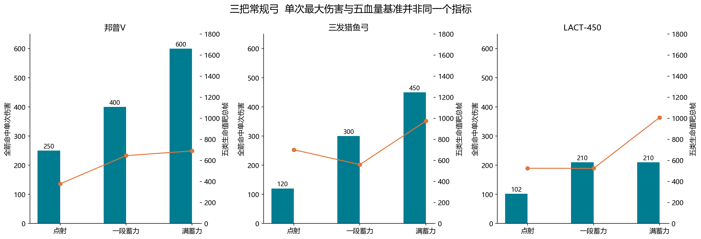

*图 1　三弓的完整动作比较。柱表示全箭命中的单次伤害，折线表示该固定模式完成五项生命值靶所需的合计帧。*

邦普 V 的五项合计为 377 F，在本组单体基准中最短；LACT-450 的中央清杂为 189 F，整箱伤害为 8400，在本组另两项中更有利。三发猎鱼弓的五项合计为 560 F。由此可见，“单次伤害高”“清理这个队形快”和“整箱输出多”可以由不同模式或不同武器取得，不能只用满蓄面板伤害替代六维比较。

箭束汇聚是这个结论的重要条件。本文主场景采用完整命中伤害包，后文另外展示有效汇聚比例变化时的结果；该变化是实验条件响应，不代表已经测得玩家命中率分布。

## 3 各类武器横评

以下比较先在类别内解释动作差异，再使用同一普通武器锚点观察跨类分数。每个维度可以选择不同完整模式；六维高点并不表示一套动作能够同时实现全部高点。所有“最短”均指本文固定生命值靶或中央点阵条件。

### 3.1 射击枪

14 把普通射击枪分别保留全自动、三连发、开瓶首发与长按等时序。三连发包含连发内间隔、末发停顿和下一轮起手，不能按连续全自动估算。类内五项生命值靶和中央清杂最短均为广域标记枪，分别为 440 F 和 146 F。专业模型枪 MG 与广域标记枪的涂墨分达到 5.0，新叶射击枪的整箱伤害分为本组最高 4.2。

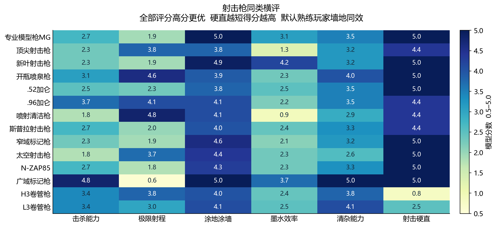

*图 2　普通射击枪六维评分。*

短射程高频输出在固定靶中有利，但真实接敌需要付出距离成本。射击枪的评价因此应同时阅读射程和任务模型中的接敌时间；单项冷启动基准没有把短射程的接近风险转成额外伤害惩罚。

### 3.2 爆破枪

7 把普通爆破枪把单体直击、同发爆风与动作周期分别处理。S-BLAST92 的五项合计为 550 F，在本组最短；冲涂爆破枪的中央清杂为 369 F，在本组最短。爆破枪的爆风能否覆盖多个目标，取决于爆心与队形，而不是“有爆炸就必然清杂高”。

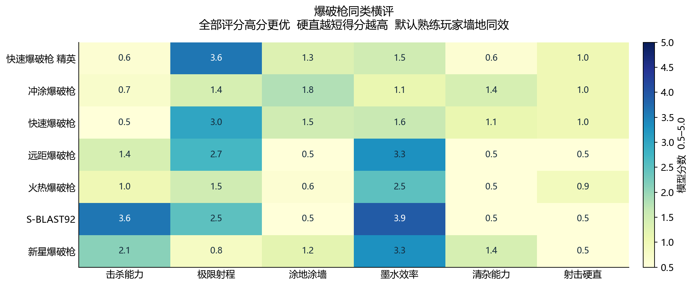

*图 3　普通爆破枪六维评分。*

本轮规则点阵下，爆破枪的中央清杂分整体并不突出。这是目标间距、有效伤害和攻击周期共同形成的结果，不能直接外推为所有聚怪场景的结论。涂墨主场景已经按熟练操作使用合适爆点，没有因玩家操作阈值另加默认折扣；伤害最远边缘与爆点墙涂仍需分别理解。

### 3.3 机动枪

6 把普通机动枪分别计算普通射击和翻滚后状态，翻滚的进入时间与耗墨进入对应模式。溅镀枪的五项合计 448 F、中央清杂 137 F，均为本组最短。灭熄 FF 的射程分为 4.6、涂墨分为 5.0，呈现另一种能力组合。

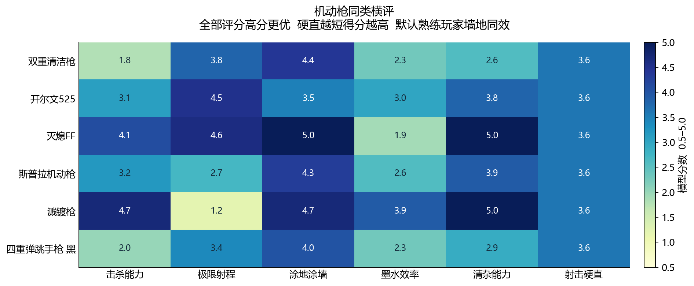

*图 4　普通机动枪六维评分。*

翻滚提高状态转换和位置调整的可能性，但本轮没有把位移直接换成生存率加成。普通射击取消与翻滚后的剩余潜墨锁定分别保留，避免用“可以翻滚”替代严格的射击硬直计时。

### 3.4 蓄力狙击枪

6 把普通狙击枪枚举点射、满蓄与适用的储存连续射击。R-PEN/5H 的五项合计为 667 F，在本组最短；公升 4K 的中央清杂为 191 F，在本组最短，其射程分达到 5.0。铅笔按整包预付墨耗，下一包重新支付墨耗与蓄力，余墨不足时补墨。

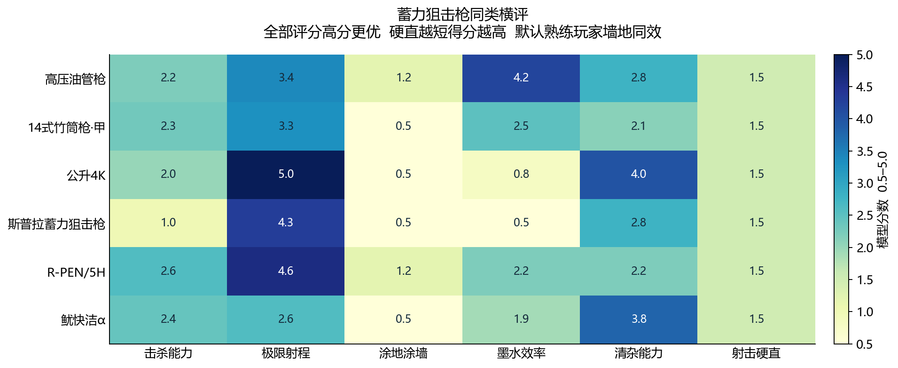

*图 5　普通蓄力狙击枪六维评分。*

高单发伤害在跨过生命阈值时有效，未跨过时可能需要再支付整次蓄力；贯通则只在目标落入相应通道时产生群体收益。准备时间、单体阈值、贯通清杂和远距离作业必须分别比较。主场景从未预蓄力开始，不能把这些数字当成已经提前蓄满时的第一发速度。

### 3.5 旋转枪

6 把普通旋转枪拆分蓄力批次和射击阶段，第二段蓄力字段按达到满蓄的总阈值处理，不再与第一段重复相加。圆珠笔的五项合计为 563 F、中央清杂为 178 F，均为本组最短；圆珠笔和审查者的整箱伤害分达到 5.0。

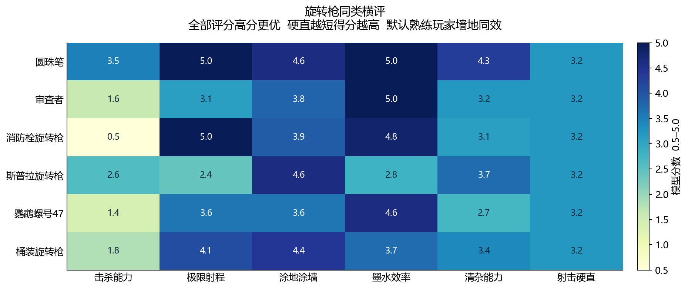

*图 6　普通旋转枪六维评分。*

旋转枪的长批次输出有利于摊薄蓄力成本，也可能在短任务中支付用不完的弹包。整箱弹数、初次准备、后续补墨和取消窗口共同决定任务时间。圆珠笔短、长射程状态分别读取对应参数，不能用一个平均射程代表所有射击阶段。

### 3.6 滚筒

5 把普通滚筒将横甩、竖甩和碾压拆开。可变式滚筒的五项合计为 763 F，在本组最短；电动马达滚筒的中央清杂为 123 F，在本组最短，清杂分达到 5.0。宽滚筒的涂墨分为本组最高 2.5。

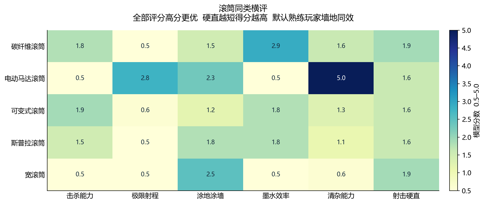

*图 7　普通滚筒六维评分。*

碾压无法一次击杀对应目标时，模型不假设可以无视击退连续接触。整箱伤害采用甩击，涂路任务可以采用滚动。平地射程排除要求起跳的竖甩；因此某武器的伤害最优模式和本次射程最优模式可能不同。

### 3.7 画笔

3 把普通画笔分别处理挥刷与推行。文森的五项合计为 419 F、中央清杂为 167 F，均为本组最短；巴勃罗的涂墨分达到 5.0。挥刷产生多滴墨，不表示一个目标可以叠加所有墨滴伤害，单体按对应弹组规则结算。

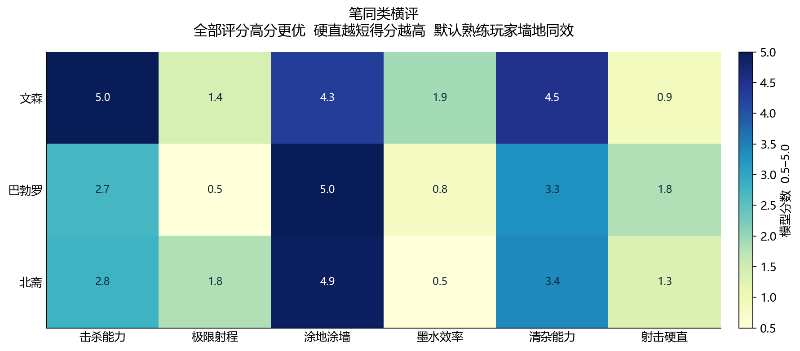

*图 8　普通画笔六维评分。*

挥刷输出、推行覆盖与墨耗采用不同动作周期；手动连打上限仍受操作节奏影响。当前数据反映参数动作的理论节奏，没有根据玩家手速分布做额外修正。

### 3.8 泼桶

6 把普通泼桶保留多段、延迟弹、贯通核心与爆炸等事件。满溢泡澡泼桶的五项合计为 518 F，在本组最短；爆炸泼桶的中央清杂为 182 F，在本组最短。洗笔桶的涂墨分为本组最高 3.1，墨瀑淋的硬直分为本组最高 3.0。

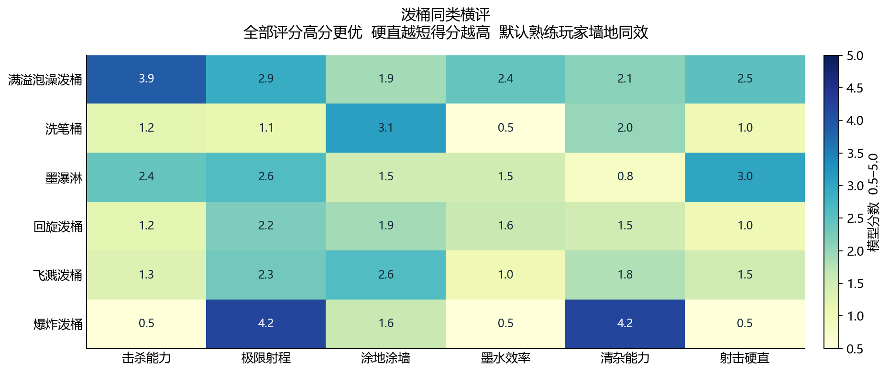

*图 9　普通泼桶六维评分。*

单体在首次致死事件结算，多段后续事件不必等待全部发完才承认击杀；群体模型由于缺少完整的逐子弹目标遮罩，按一次动作最后有效事件更新清杂时间。浴缸的多次弹跳射程尚未完整复现，不能把首次落地距离当成其精确全程极限。

### 3.9 防空伞

4 把普通防空伞的单目标散弹伤害受对应上限约束。露营防空伞的五项合计为 505 F，在本组最短；特工配件的中央清杂为 295 F，在本组最短。遮阳防空伞与露营防空伞的整箱伤害分并列本组最高 4.5。

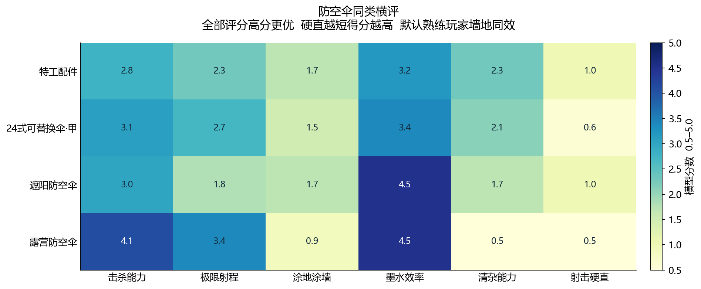

*图 10　普通防空伞六维评分。*

散弹颗数乘单弹伤害不能替代单体上限；最远一颗散弹触及目标，也不表示远端仍有整发最大伤害。伞面抵挡、展开、重建和地形交互保留为机制信息，本轮没有据此虚构防御概率或给射击硬直额外奖励。

### 3.10 刮水刀

3 把普通刮水刀将剑气、刀身近战及对应时序分开。雨刷刮水刀的五项合计为 423 F，在本组最短；工作刮水刀的中央清杂为 192 F，在本组最短。雨刷与工作刮水刀的击杀分均达到 5.0，雨刷的整箱伤害分也达到 5.0。

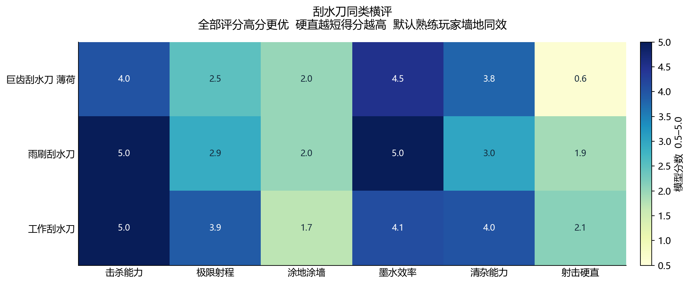

*图 11　普通刮水刀六维评分。*

近战伤害优势需要接近目标。单项击杀可以选择近战，任务模型则按实际采用模式的距离支付接敌时间，不借用另一种远程模式的最远射程。普通刀硬直统一到剑气事件零点，刀身更早发生的攻击事件另行保留。

### 3.11 猎鱼弓

3 把普通猎鱼弓的横评与第 2 节模式实例相对应。邦普 V 的击杀分达到 5.0，LACT-450 的中央清杂分为 4.0、整箱伤害分为 5.0；邦普 V 与三发猎鱼弓的射程分达到 5.0。

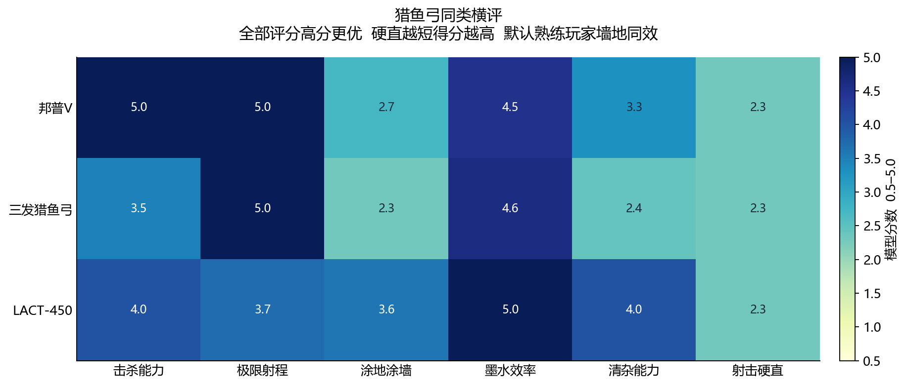

*图 12　普通猎鱼弓六维评分。*

生命阈值可能让一段蓄力优于满蓄，清杂覆盖又可能偏向另一种散布。箭束单体汇聚、独立箭分配和滞留爆区并集分别处理；不能仅把所有箭的伤害相加，就认定所有距离和队形都能实现该伤害包。

### 3.12 熊先生武器

8 把熊先生武器沿用普通武器锚点。熊狙的五项合计为 93 F、中央清杂为 17 F，均为本组最短；熊弓的五项合计为 236 F。熊刀整箱伤害为 7200，整箱伤害分为本组最高 4.5。

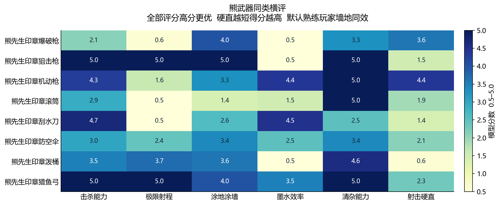

*图 13　熊先生武器六维评分，使用普通武器锚点。*

超出普通武器高锚点后，分数会饱和；例如多个 5.0 需要回到原始量继续比较。熊武器的装甲处理、特殊事件适性、高耗墨和接近风险没有被压成一个未经验证的统一加成；部分射击硬直仍使用参数代理，应结合证据记录阅读。

## 4 六维关联与任务时间

### 4.1 用同一时间尺度连接不同能力

六维分别使用帧、距离、面积和伤害，直接相加需要人为规定权重。本文另外构造任务序列，把固定作业量转为完成时间，让伤害阈值、共享墨量、覆盖、退出窗口和接敌距离在同一个资源时序中作用：

$$
T_{\mathrm{task}}=T_{\mathrm{boss}}+T_{\mathrm{mob}}+T_{\mathrm{ground}}+
T_{\mathrm{wall}}+T_{\mathrm{release}}+T_{\mathrm{refill}}+T_{\mathrm{approach}}.
$$

| 场景 | 五项靶套数 | 混合杂鱼组数 | 地面面积 | 墙面面积 | 每战斗块起始距离 |
| --- | ---: | ---: | ---: | ---: | ---: |
| 均衡任务 | 1 | 2 | 240 | 48 | 18 |
| 战斗偏重 | 2 | 3 | 80 | 16 | 24 |
| 环境维护偏重 | 1 | 1 | 480 | 120 | 12 |

任务之间携带剩余墨量，动作进入和整包费用不能免费借用；每个任务块支付实际模式的退出窗口。覆盖任务按完整动作累计到目标面积，不用稳态速率把任务完成时间提前到首发之前。接敌采用各战斗块实际选中模式的射程代理，超出时支付：

$$
T_{\mathrm{approach},j}=\frac{\max(0,L_j-R_j)}{0.18}.
$$

$L_j$ 为场景起始距离，$R_j$ 为该块实际模式的射程，0.18 为统一假设接敌速度。该串行模型用于公开条件下的比较，没有模拟真实队友并行分工。

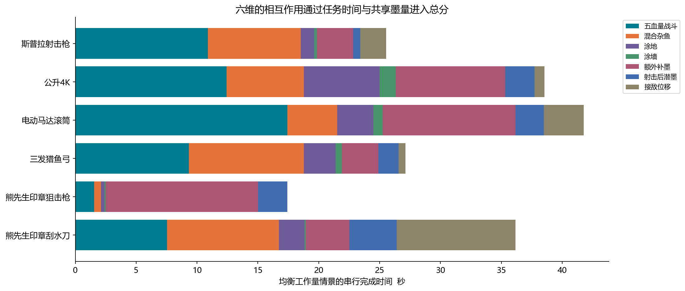

*图 14　均衡任务的时间组成。额外补墨、射后潜墨和接敌位移分别列出。*

整箱伤害高可以减少补墨，射程长只在目标超出攻击范围时节省接敌时间，较短的退出窗口则在任务转换时减少等待。相反，六维中的最低硬直、最大射程和最大覆盖可能来自不同模式，任务模型不能同时免费使用这些单项最佳状态。

### 4.2 分维度取舍

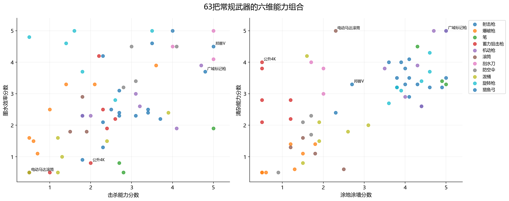

*图 15　63 把普通武器的能力组合。每个点表示同一把武器的两个分维度得分。*

图 15 展示了能力组合。击杀快和整箱伤害高并非同一指标：前者受到生命阈值和初次准备影响，后者计算整箱可支付输出。涂墨与清杂也共享部分覆盖参数，却分别受到地面几何、目标生命、攻击周期和队形约束。分维度图适合解释用途，不能据此认定两个指标之间存在实际对局的因果关系。

### 4.3 任务模型综合分与原评分对照

各任务场景分别以普通武器完成时间的倒数取对数校准，得到 0.5–5.0 分；三场景分数等权平均，形成独立的任务模型综合分。图 16 的线段表示三场景分数范围，灰点为原有人工总分，蓝点为任务模型均值。

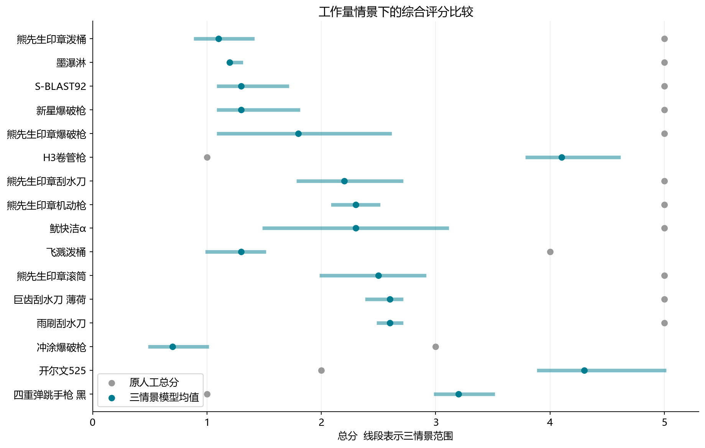

*图 16　任务模型综合分与原总分的对照，展示差异较大的 16 把武器。*

| 武器示例 | 原 overall | 任务模型综合分 | 三场景分数范围 | 三场景名次范围 |
| --- | --- | --- | --- | --- |
| 熊先生印章猎鱼弓 | 5.0 | 5.0 | 5.0–5.0 | 1–3 |
| 溅镀枪 | 5.0 | 5.0 | 5.0–5.0 | 4–4 |
| 广域标记枪 | 5.0 | 5.0 | 5.0–5.0 | 1–6 |
| 圆珠笔 | 4.0 | 4.9 | 4.6–5.0 | 2–9 |
| 熊先生印章狙击枪 | 5.0 | 4.8 | 4.4–5.0 | 2–10 |
| .96加仑 | 3.0 | 4.8 | 4.6–5.0 | 3–7 |
| L3卷管枪 | 4.0 | 4.6 | 4.4–5.0 | 6–11 |
| 新叶射击枪 | 3.0 | 4.4 | 4.1–5.0 | 5–13 |
| 开尔文525 | 2.0 | 4.3 | 3.9–5.0 | 5–20 |
| 专业模型枪MG | 3.0 | 4.3 | 4.0–4.6 | 7–15 |

表中的高分只对应已列任务量与操作条件。任务模型并非原视频的总分公式，也没有覆盖全部特殊事件适性。项目保留原 `overall` 与 `tier`，以便用户继续沿用原有评分，同时查看本次六维与任务模型对照。完整结果见[对照 CSV](../analysis/weapon_evaluation/v2/comparison.csv)。

## 5 全武器结果

以下热图和表格覆盖全部 71 把武器。六维均为高分更有利，“硬直”高分表示射后更早开始潜墨。普通类别不含熊武器，熊武器在末尾单列；分数并列时应继续比较原始基准量和动作条件。

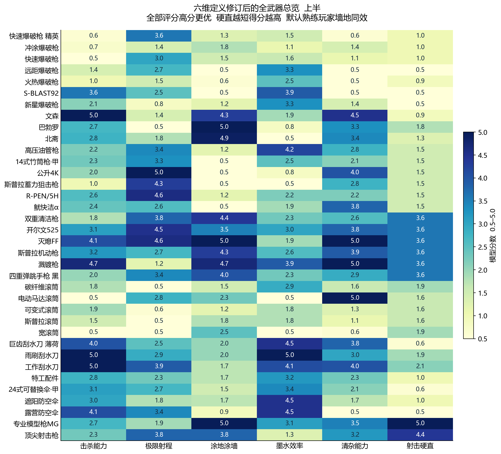

*图 17　全武器六维总览，上半。*

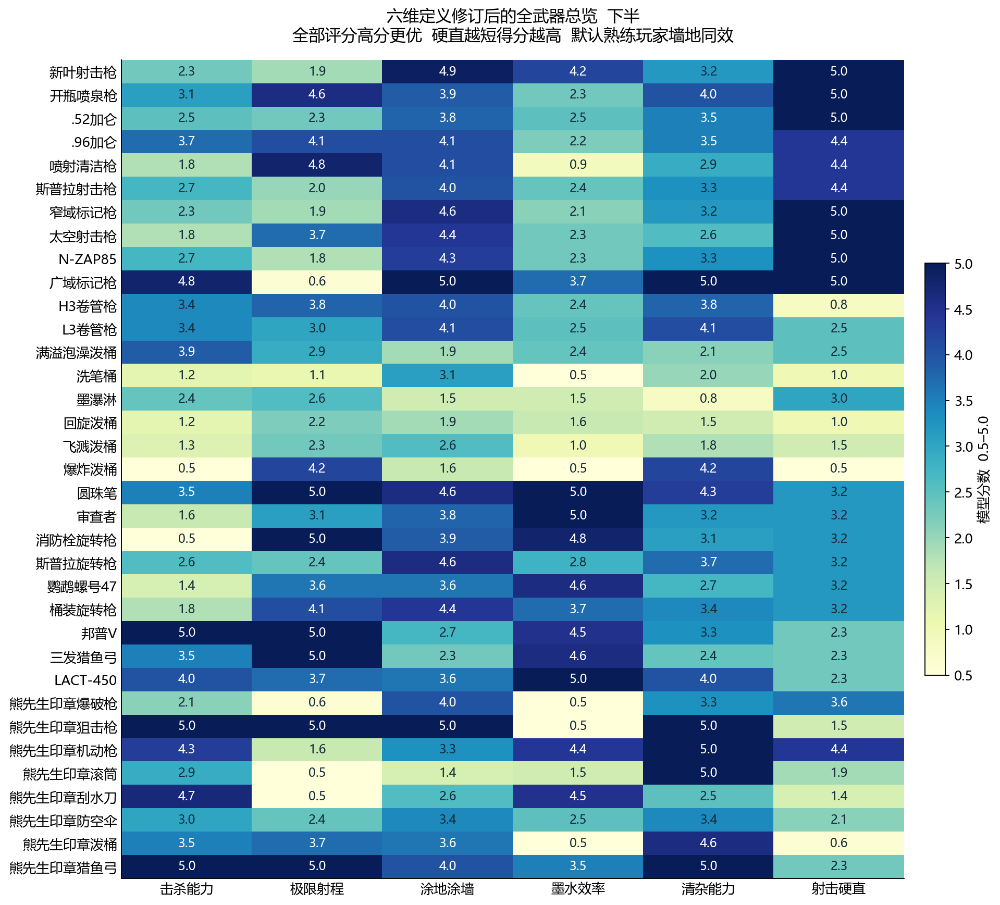

*图 18　全武器六维总览，下半。*

表中“任务综合”是第 4 节独立模型结果，**不是已经替换后的网页总分**。本表可与[六维 CSV](../analysis/weapon_evaluation/v2/scores.csv)和[原始量 CSV](../analysis/weapon_evaluation/v2/benchmarks.csv)逐行核对。

| 武器 | 类别 | 击杀 | 射程 | 涂墨 | 整箱伤害 | 清杂 | 硬直 | 任务综合 |
| --- | --- | --- | --- | --- | --- | --- | --- | --- |
| 专业模型枪MG | 射击枪 | 2.7 | 1.9 | 5.0 | 3.1 | 3.5 | 5.0 | 4.3 |
| 顶尖射击枪 | 射击枪 | 2.3 | 3.8 | 3.8 | 1.3 | 3.2 | 4.4 | 3.8 |
| 新叶射击枪 | 射击枪 | 2.3 | 1.9 | 4.9 | 4.2 | 3.2 | 5.0 | 4.4 |
| 开瓶喷泉枪 | 射击枪 | 3.1 | 4.6 | 3.9 | 2.3 | 4.0 | 5.0 | 4.1 |
| .52加仑 | 射击枪 | 2.5 | 2.3 | 3.8 | 2.5 | 3.5 | 5.0 | 4.1 |
| .96加仑 | 射击枪 | 3.7 | 4.1 | 4.1 | 2.2 | 3.5 | 4.4 | 4.8 |
| 喷射清洁枪 | 射击枪 | 1.8 | 4.8 | 4.1 | 0.9 | 2.9 | 4.4 | 3.5 |
| 斯普拉射击枪 | 射击枪 | 2.7 | 2.0 | 4.0 | 2.4 | 3.3 | 4.4 | 4.0 |
| 窄域标记枪 | 射击枪 | 2.3 | 1.9 | 4.6 | 2.1 | 3.2 | 5.0 | 3.6 |
| 太空射击枪 | 射击枪 | 1.8 | 3.7 | 4.4 | 2.3 | 2.6 | 5.0 | 3.8 |
| N-ZAP85 | 射击枪 | 2.7 | 1.8 | 4.3 | 2.3 | 3.3 | 5.0 | 4.0 |
| 广域标记枪 | 射击枪 | 4.8 | 0.6 | 5.0 | 3.7 | 5.0 | 5.0 | 5.0 |
| H3卷管枪 | 射击枪 | 3.4 | 3.8 | 4.0 | 2.4 | 3.8 | 0.8 | 4.1 |
| L3卷管枪 | 射击枪 | 3.4 | 3.0 | 4.1 | 2.5 | 4.1 | 2.5 | 4.6 |
| 快速爆破枪 精英 | 爆破枪 | 0.6 | 3.6 | 1.3 | 1.5 | 0.6 | 1.0 | 0.8 |
| 冲涂爆破枪 | 爆破枪 | 0.7 | 1.4 | 1.8 | 1.1 | 1.4 | 1.0 | 0.7 |
| 快速爆破枪 | 爆破枪 | 0.5 | 3.0 | 1.5 | 1.6 | 1.1 | 1.0 | 1.1 |
| 远距爆破枪 | 爆破枪 | 1.4 | 2.7 | 0.5 | 3.3 | 0.5 | 0.5 | 0.5 |
| 火热爆破枪 | 爆破枪 | 1.0 | 1.5 | 0.6 | 2.5 | 0.5 | 0.9 | 0.6 |
| S-BLAST92 | 爆破枪 | 3.6 | 2.5 | 0.5 | 3.9 | 0.5 | 0.5 | 1.3 |
| 新星爆破枪 | 爆破枪 | 2.1 | 0.8 | 1.2 | 3.3 | 1.4 | 0.5 | 1.3 |
| 双重清洁枪 | 机动枪 | 1.8 | 3.8 | 4.4 | 2.3 | 2.6 | 3.6 | 3.8 |
| 开尔文525 | 机动枪 | 3.1 | 4.5 | 3.5 | 3.0 | 3.8 | 3.6 | 4.3 |
| 灭熄FF | 机动枪 | 4.1 | 4.6 | 5.0 | 1.9 | 5.0 | 3.6 | 3.9 |
| 斯普拉机动枪 | 机动枪 | 3.2 | 2.7 | 4.3 | 2.6 | 3.9 | 3.6 | 4.1 |
| 溅镀枪 | 机动枪 | 4.7 | 1.2 | 4.7 | 3.9 | 5.0 | 3.6 | 5.0 |
| 四重弹跳手枪 黑 | 机动枪 | 2.0 | 3.4 | 4.0 | 2.3 | 2.9 | 3.6 | 3.2 |
| 高压油管枪 | 蓄力狙击枪 | 2.2 | 3.4 | 1.2 | 4.2 | 2.8 | 1.5 | 2.4 |
| 14式竹筒枪·甲 | 蓄力狙击枪 | 2.3 | 3.3 | 0.5 | 2.5 | 2.1 | 1.5 | 1.5 |
| 公升4K | 蓄力狙击枪 | 2.0 | 5.0 | 0.5 | 0.8 | 4.0 | 1.5 | 1.8 |
| 斯普拉蓄力狙击枪 | 蓄力狙击枪 | 1.0 | 4.3 | 0.5 | 0.5 | 2.8 | 1.5 | 0.8 |
| R-PEN/5H | 蓄力狙击枪 | 2.6 | 4.6 | 1.2 | 2.2 | 2.2 | 1.5 | 1.9 |
| 鱿快洁α | 蓄力狙击枪 | 2.4 | 2.6 | 0.5 | 1.9 | 3.8 | 1.5 | 2.3 |
| 圆珠笔 | 旋转枪 | 3.5 | 5.0 | 4.6 | 5.0 | 4.3 | 3.2 | 4.9 |
| 审查者 | 旋转枪 | 1.6 | 3.1 | 3.8 | 5.0 | 3.2 | 3.2 | 3.4 |
| 消防栓旋转枪 | 旋转枪 | 0.5 | 5.0 | 3.9 | 4.8 | 3.1 | 3.2 | 1.9 |
| 斯普拉旋转枪 | 旋转枪 | 2.6 | 2.4 | 4.6 | 2.8 | 3.7 | 3.2 | 4.1 |
| 鹦鹉螺号47 | 旋转枪 | 1.4 | 3.6 | 3.6 | 4.6 | 2.7 | 3.2 | 3.4 |
| 桶装旋转枪 | 旋转枪 | 1.8 | 4.1 | 4.4 | 3.7 | 3.4 | 3.2 | 4.0 |
| 碳纤维滚筒 | 滚筒 | 1.8 | 0.5 | 1.5 | 2.9 | 1.6 | 1.9 | 1.2 |
| 电动马达滚筒 | 滚筒 | 0.5 | 2.8 | 2.3 | 0.5 | 5.0 | 1.6 | 1.2 |
| 可变式滚筒 | 滚筒 | 1.9 | 0.6 | 1.2 | 1.8 | 1.3 | 1.6 | 0.8 |
| 斯普拉滚筒 | 滚筒 | 1.5 | 0.5 | 1.8 | 1.8 | 1.1 | 1.6 | 1.0 |
| 宽滚筒 | 滚筒 | 0.5 | 0.5 | 2.5 | 0.5 | 0.6 | 1.9 | 0.5 |
| 文森 | 画笔 | 5.0 | 1.4 | 4.3 | 1.9 | 4.5 | 0.9 | 3.4 |
| 巴勃罗 | 画笔 | 2.7 | 0.5 | 5.0 | 0.8 | 3.3 | 1.8 | 2.6 |
| 北斋 | 画笔 | 2.8 | 1.8 | 4.9 | 0.5 | 3.4 | 1.3 | 2.7 |
| 满溢泡澡泼桶 | 泼桶 | 3.9 | 2.9 | 1.9 | 2.4 | 2.1 | 2.5 | 2.7 |
| 洗笔桶 | 泼桶 | 1.2 | 1.1 | 3.1 | 0.5 | 2.0 | 1.0 | 1.0 |
| 墨瀑淋 | 泼桶 | 2.4 | 2.6 | 1.5 | 1.5 | 0.8 | 3.0 | 1.2 |
| 回旋泼桶 | 泼桶 | 1.2 | 2.2 | 1.9 | 1.6 | 1.5 | 1.0 | 1.4 |
| 飞溅泼桶 | 泼桶 | 1.3 | 2.3 | 2.6 | 1.0 | 1.8 | 1.5 | 1.3 |
| 爆炸泼桶 | 泼桶 | 0.5 | 4.2 | 1.6 | 0.5 | 4.2 | 0.5 | 1.2 |
| 特工配件 | 防空伞 | 2.8 | 2.3 | 1.7 | 3.2 | 2.3 | 1.0 | 2.8 |
| 24式可替换伞·甲 | 防空伞 | 3.1 | 2.7 | 1.5 | 3.4 | 2.1 | 0.6 | 2.4 |
| 遮阳防空伞 | 防空伞 | 3.0 | 1.8 | 1.7 | 4.5 | 1.7 | 1.0 | 2.6 |
| 露营防空伞 | 防空伞 | 4.1 | 3.4 | 0.9 | 4.5 | 0.5 | 0.5 | 1.7 |
| 巨齿刮水刀 薄荷 | 刮水刀 | 4.0 | 2.5 | 2.0 | 4.5 | 3.8 | 0.6 | 2.6 |
| 雨刷刮水刀 | 刮水刀 | 5.0 | 2.9 | 2.0 | 5.0 | 3.0 | 1.9 | 2.6 |
| 工作刮水刀 | 刮水刀 | 5.0 | 3.9 | 1.7 | 4.1 | 4.0 | 2.1 | 3.2 |
| 邦普V | 猎鱼弓 | 5.0 | 5.0 | 2.7 | 4.5 | 3.3 | 2.3 | 4.2 |
| 三发猎鱼弓 | 猎鱼弓 | 3.5 | 5.0 | 2.3 | 4.6 | 2.4 | 2.3 | 3.8 |
| LACT-450 | 猎鱼弓 | 4.0 | 3.7 | 3.6 | 5.0 | 4.0 | 2.3 | 4.1 |
| 熊先生印章爆破枪 | 熊先生武器 | 2.1 | 0.6 | 4.0 | 0.5 | 3.3 | 3.6 | 1.8 |
| 熊先生印章狙击枪 | 熊先生武器 | 5.0 | 5.0 | 5.0 | 0.5 | 5.0 | 1.5 | 4.8 |
| 熊先生印章机动枪 | 熊先生武器 | 4.3 | 1.6 | 3.3 | 4.4 | 5.0 | 4.4 | 2.3 |
| 熊先生印章滚筒 | 熊先生武器 | 2.9 | 0.5 | 1.4 | 1.5 | 5.0 | 1.9 | 2.5 |
| 熊先生印章刮水刀 | 熊先生武器 | 4.7 | 0.5 | 2.6 | 4.5 | 2.5 | 1.4 | 2.2 |
| 熊先生印章防空伞 | 熊先生武器 | 3.0 | 2.4 | 3.4 | 2.5 | 3.4 | 2.1 | 3.6 |
| 熊先生印章泼桶 | 熊先生武器 | 3.5 | 3.7 | 3.6 | 0.5 | 4.6 | 0.6 | 1.1 |
| 熊先生印章猎鱼弓 | 熊先生武器 | 5.0 | 5.0 | 4.0 | 3.5 | 5.0 | 2.3 | 5.0 |

## 6 敏感性与讨论

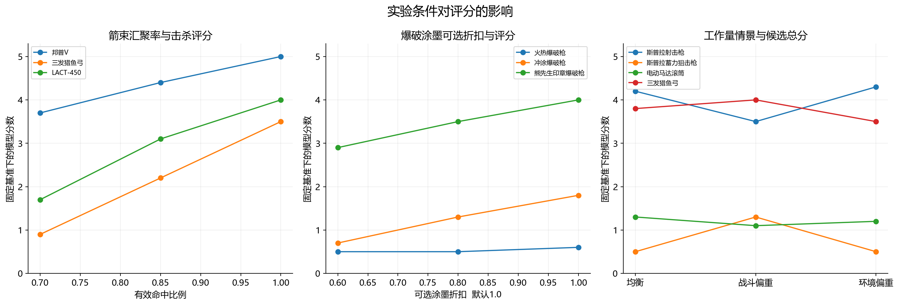

*图 19　实验条件变化时的评分响应。主场景有效命中比例和爆破涂墨系数均为 1.0。*

图 19 分别改变箭束有效汇聚比例、爆破涂墨可选折扣和任务工作量。箭束敏感性通过缩放有效伤害包实现，没有随机模拟逐箭射失轨迹。默认仍使用完整伤害包与墙地同效；折扣是偏离主条件的敏感性试验。群体队形、补墨时长、覆盖有效比例和目标距离也会改变长蓄力、高耗墨、贯通与爆风武器的相对结果。

| 武器示例 | 三队形最短帧 | 三队形最长帧 | 差值 |
| --- | --- | --- | --- |
| 熊先生印章泼桶 | 76 | 926 | 850 |
| 远距爆破枪 | 71 | 551 | 480 |
| S-BLAST92 | 66 | 506 | 440 |
| 爆炸泼桶 | 72 | 512 | 440 |
| 露营防空伞 | 61 | 461 | 400 |
| 墨瀑淋 | 70 | 430 | 360 |
| 宽滚筒 | 97 | 448 | 351 |

这些区间是确定性实验条件之间的响应，不是玩家表现的统计置信区间，也不证明真实敌人可以在同一点重合。中央点阵与分散、聚集情景共同用于说明固定队形结果的适用边界。

当前模型能够分离生命阈值、资源容量与环境作业负担，但仍有以下限制：

1. **交战条件。** 生命值靶没有完整模拟 Boss 弱点窗口、敌人运动、地图高低差、装甲切换与队友协作。特殊事件适性需要另设任务，不能从六维均值直接恢复。
2. **模式搜索。** 基准逐项枚举已定义完整模式；清杂采用即时有效伤害贪心选择。没有证明任意半蓄、跨模式组合或全局瞄准路线的最优性。
3. **射程与覆盖。** 目标碰撞体、枪口动画、部分特殊弹道和墙面墨迹生成尚未全部复现。墙地同效是熟练操作比较条件，需要统一墙距和动作节奏的实机实验进一步校准。
4. **硬直版本。** 10.0.1 逐帧资料与 11.1.0 参数共同使用，缺测项目的参数收招代理与直接逐帧记录分别保存。不能把全部采用值称为 11.1.0 实测。
5. **评分尺度。** 分位数锚点和裁剪有利于稳定展示，但会压缩两端差异；一位小数也会产生并列。任务综合分取决于公开工作量，没有对实际通关率或独立对局结果进行拟合验证。

后续验证应优先录制固定目标、距离和墙面条件下的逐帧过程，对照实际命中分配、补墨次数、墙地覆盖和潜墨开始时刻；再用独立固定场景检验任务完成时间是否能够预测实际结果。需要更新的是具体参数映射和情景条件，而不是先要求模型复现一张预定排名。

## 7 复算入口

| 入口 | 用途 |
| --- | --- |
| [参数快照](../data/weapon_data_1110/) | 合并后的普通武器 Coop 参数与熊武器参数 |
| [通用模式提取](../analysis/weapon_evaluation/extract_common.py) | 将各类字段转成独立攻击模式 |
| [初始模式分析入口](../analysis/weapon_evaluation/evaluate.py) | 生成 v2 读取的通用模式记录 |
| [v2 评估入口](../analysis/weapon_evaluation/v2/evaluate_v2.py) | 六维聚合、分位数校准、三类任务和 CSV 导出 |
| [生命值与清杂事件模型](../analysis/weapon_evaluation/v2/scenarios.py) | 分阶段生命值、完整动作、资源支付和队形处理 |
| [串行任务资源模型](../analysis/weapon_evaluation/v2/workload_sequence.py) | 跨任务共享墨量、退出窗口和补墨时序 |
| [字段适配](../analysis/weapon_evaluation/v2/field_adapters.py) | 射程代理、潜墨计时来源和墙距诊断 |
| [模型配置](../analysis/weapon_evaluation/v2/model_config.json) | 目标生命、密度、补墨、覆盖与任务工作量 |
| [硬直证据记录](../analysis/weapon_evaluation/v2/notes/endlag_measurements.json) | 逐武器测量起点、来源版本、事件偏移和缺测 |
| [中文数值图生成脚本](../analysis/weapon_evaluation/v2/generate_figures_v2.py) | 由完整计算结果生成本文图表 |

仓库已保留 v2 需要的初始模式记录。在仓库根目录安装依赖后，可以直接复算当前版本并检查结果：

```powershell
python -m pip install -r analysis/weapon_evaluation/requirements.txt
python analysis/weapon_evaluation/v2/evaluate_v2.py
python analysis/weapon_evaluation/v2/validate_v2.py
python analysis/weapon_evaluation/v2/generate_figures_v2.py
```

上述命令会在本地生成详细事件轨迹 JSON、CSV 和图表；未使用 `--write`，因此不会重新写入正式武器评分。公开仓库保留紧凑 CSV、代码、参数与方法记录，较大的逐事件计算结果可在本地重新生成。当前绘图脚本使用 Windows 微软雅黑字体路径，其他系统需要将该路径改为本机可用的中文字体。

## 参考文献

以下资料核对日期为 2026 年 11 月 3 日。数值结果来自本项目冻结快照；外部资料用于参数来源、字段语义、生命值和动作时序核对。

<a id="ref-1"></a>
[1] Leanny. [Splatoon 3 解包参数仓库](https://github.com/Leanny/splat3)，以及 [11.1.0 武器参数目录](https://github.com/Leanny/splat3/tree/main/data/parameter/1110/weapon)。本地计算使用项目已合并的 Coop 文件。

<a id="ref-2"></a>
[2] Inkipedia. [Salmon Run Next Wave data](https://splatoonwiki.org/wiki/Salmon_Run_Next_Wave_data)。三代敌人生命值及武器数据交叉核对入口。

<a id="ref-3"></a>
[3] XarrotD. [武器参数字段与缺省值表](https://splatoonwiki.org/wiki/User:XarrotD/paramtable)。类缺省值与字段含义的原作者研究记录，部分字段明确保留未知状态。

<a id="ref-4"></a>
[4] Splatoon3 攻略与验证 Wiki. [主武器参数验证](https://wikiwiki.jp/splatoon3mix/検証/パラメータ情報/メイン)。日文参数释义、动作字段和涂墨参数研究。

<a id="ref-5"></a>
[5] sendou.ink. [WeaponRange.ts 射程分析实现](https://github.com/sendou-ink/sendou.ink/blob/main/app/features/comp-analyzer/core/WeaponRange.ts)。分段弹道、运动参数缺省值与平地射程计算参考；这是一份分析实现，不是完整游戏引擎源码。

<a id="ref-6"></a>
[6] Splatoon3 攻略与验证 Wiki. [主武器前隙与后隙逐帧验证](https://wikiwiki.jp/splatoon3mix/検証/メインウェポン/前隙・後隙)。表格标注 10.0.1 版，定义射出、取消输入、开始潜墨等不同计时事件。
